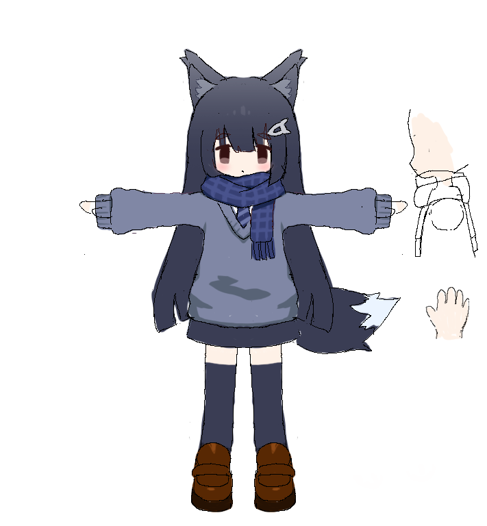
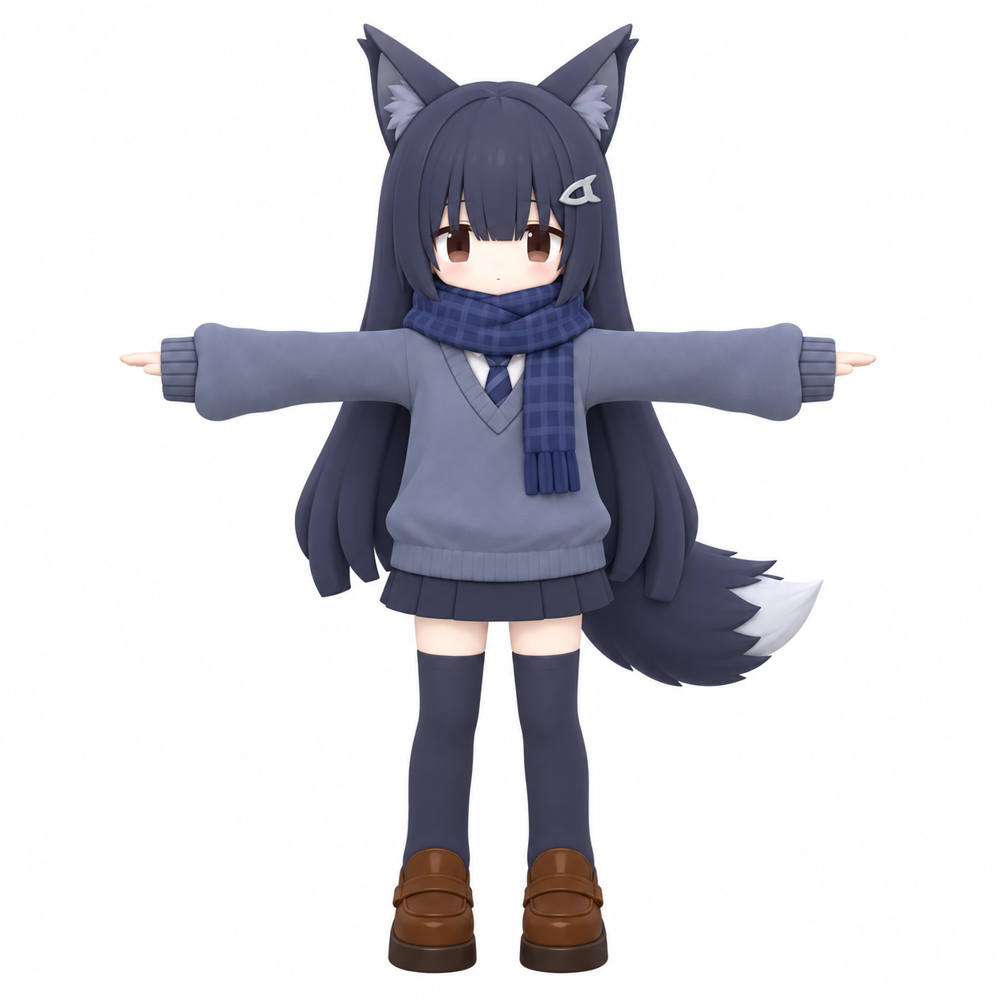
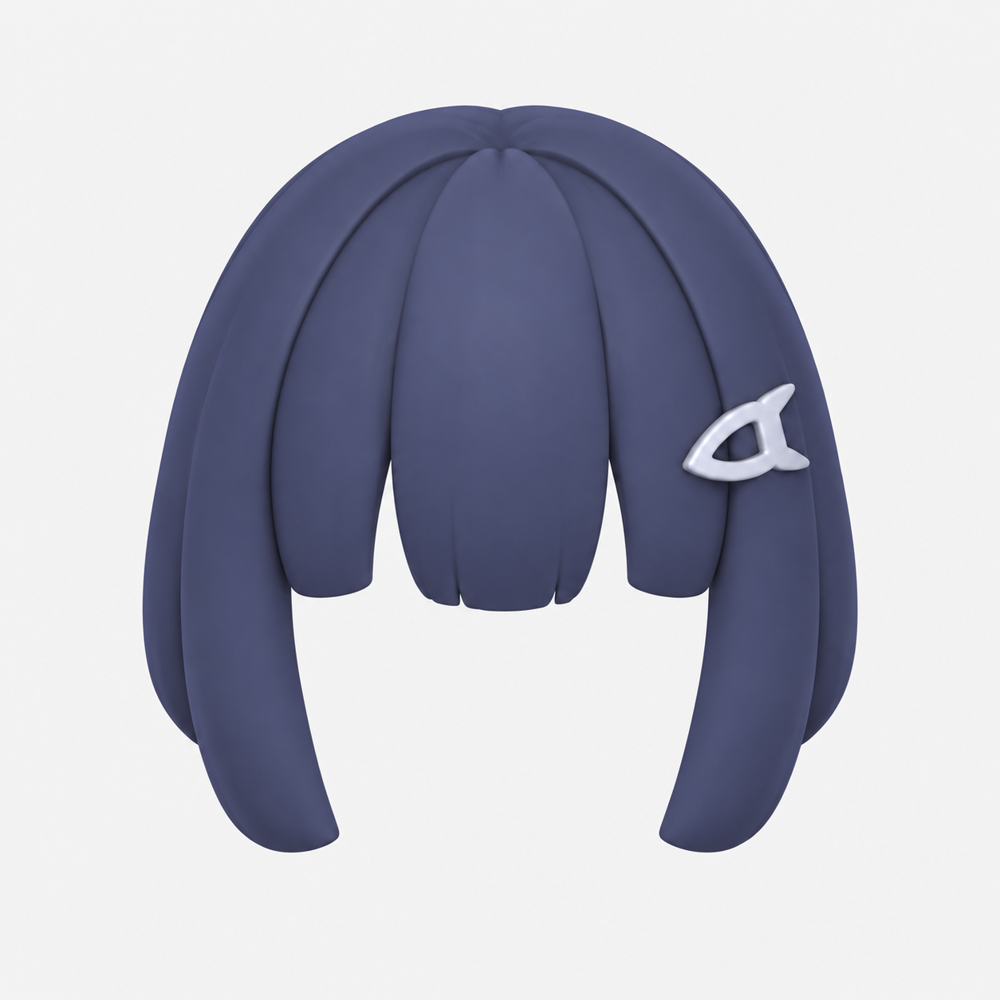
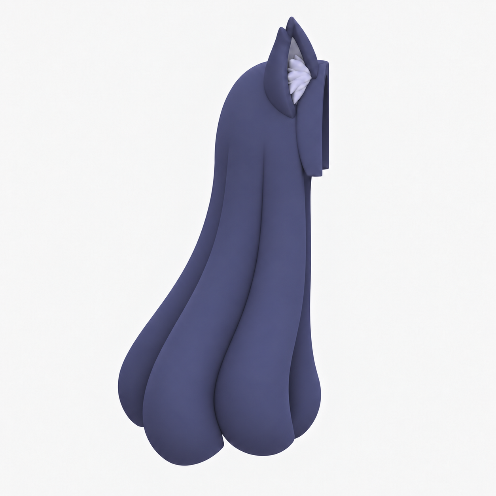
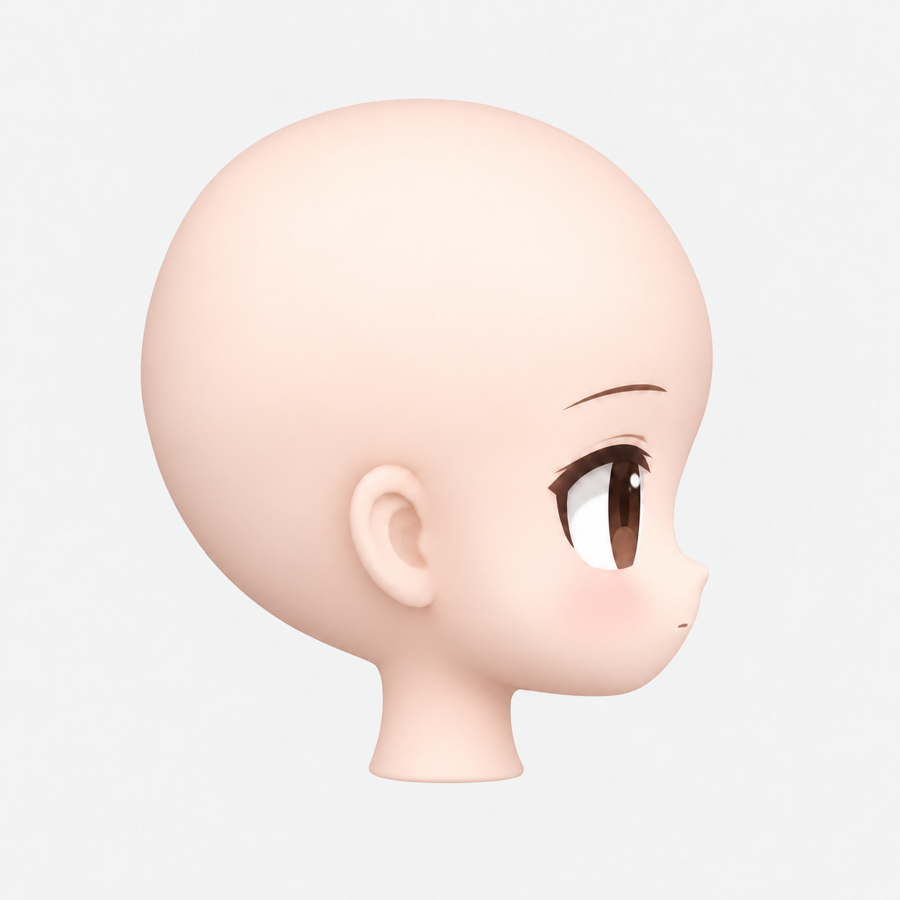
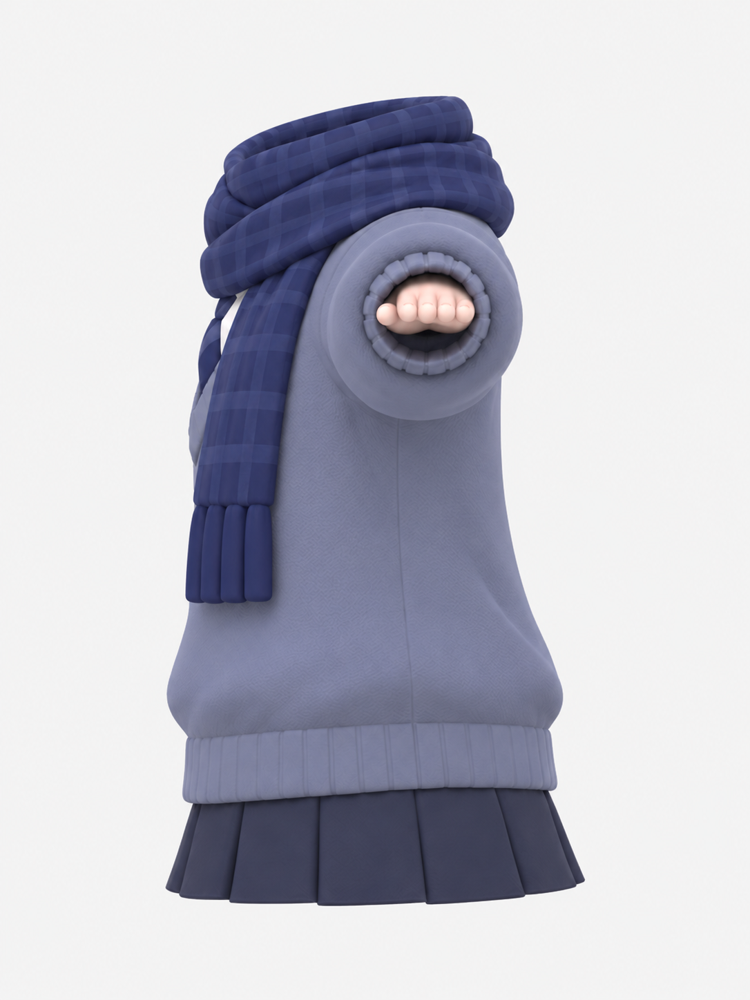
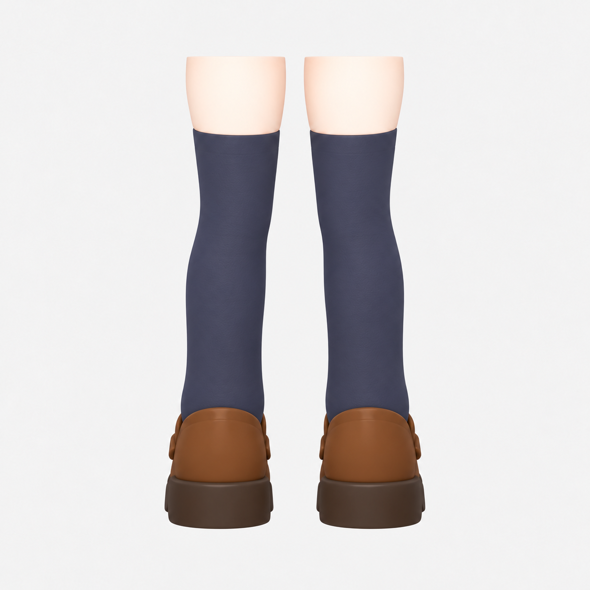

# AnimeCharacterAiSkill

一个 AI 辅助动漫角色制作的 Agent Skill（Claude Code / Codex）：从角色设定图出发，经过模块化四视图、模型 UV 与贴图整理，做到 UE5 里可以直接操控的角色。

<p align="center">
  
  &nbsp;&nbsp;
  
</p>

## 功能

| 阶段 | 做什么 | 产出 |
|---|---|---|
| ① 设定图 | 把角色拆成刘海、后发、脸、衣服与手、腿袜鞋五个模块，生成正交四视图；统一部件接口，简化头发，修正眼部阴影 | 每个模块 4 张 PNG、提示词、接口说明 |
| ② UV 与贴图 | 把 AI 模型（Tripo、Meshy 等）上的碎 UV 按部位重排成大块面板；迁移原贴图；用图像模型清理脏色和烘焙阴影；找平接缝色差；定点修正条纹、错色和接缝 | Blender、FBX、glTF 交付包，绘制辅助图，验收报告 |
| ③ UE5 实机 | 导入模型，重定向模板动作，生成角色蓝图、GameMode 和关卡，自动实机测试 | 可直接 Play 的第三人称角色、测试截图 |

<p align="center">
  
  
  
  
  
</p>

## 目录

```
Skill文件/modular-character-workflow/
├── SKILL.md                  # 技能入口：三个阶段的流程与原则
├── agents/openai.yaml        # Codex 界面信息
├── references/               # 按需读取的详细说明
│   ├── prompts.md            # 设定图提示词
│   ├── project-spec.md       # 每个角色要记录的约定
│   ├── quality-checks.md     # 三个阶段的检查清单
│   ├── uv-relayout.md        # UV 重排
│   ├── texture-processing.md # 贴图迁移、清理与修正
│   └── ue-playable-character.md
└── scripts/
    ├── origami_uv/           # UV 与贴图流水线（run.py + pipeline/）
    └── ue_character/         # UE5 构建与实机测试脚本
参考图/                        # 示例角色的设定图与模块四视图
角色设定图制作工作流.docx        # 设定图阶段的图文说明
```

## 安装

把 `Skill文件/modular-character-workflow` 整个文件夹复制到 Agent 的技能目录：

- Claude Code：`~/.claude/skills/modular-character-workflow/`
- Codex：`~/.codex/skills/modular-character-workflow/`

第二、三阶段需要的环境：

- Blender 4.x
- Python 3.11 或以上：`pip install -r scripts/origami_uv/requirements.txt`
- Unreal Engine 5.x（在 5.7 上验证），项目里需要有第三人称模板内容

## 使用

直接用自然语言描述需求，Agent 会判断当前在哪个阶段并调用技能，例如：

- “根据这张设定图，做脸部模块的四视图”
- “这个模型的 UV 太碎了，按部位重排，并把贴图整理干净”
- “袜子上这条灰线其实是阴影，去掉它”
- “把模型导入 UE5，做成可以直接操控的角色”

也可以直接运行脚本：

```bash
# 阶段二：先复制 config.example.yaml 改成项目配置
python scripts/origami_uv/run.py --config config.yaml --to-stage 3     # 先只排布，看过再继续
python scripts/origami_uv/run.py --config config.yaml --from-stage 4   # 贴图、导出、报告、打包
python scripts/origami_uv/run.py --config config.yaml --texfix-prepare # 切出要交给图像模型清理的裁块

# 阶段三：先写 ue_config.json（参考 ue_config.example.json）
UnrealEditor.exe Project.uproject -ExecutePythonScript=scripts/ue_character/ue_build_playable.py -nullrhi -unattended
UnrealEditor.exe Project.uproject -ExecCmds="py scripts/ue_character/ue_verify_play.py" -unattended
```

各参数和流程细节见 `references/` 下的文档。

## 说明

- 不包含从零建模、拓扑重建和手工绑骨。第二阶段的输入是按模块拆好的 .blend；第三阶段需要模型带骨架。
- 输入模型只读：顶点、权重、原 UV、法线都不改，导出后会回读核对。
- 流水线结果可复现，与并行进程数无关。
- 图像模型清理需要在浏览器里使用你自己的 ChatGPT 账号逐块操作，每次发送前确认。
- 示例角色的配置和清理提示词在 `scripts/origami_uv/examples/`，可作新角色的起点。
